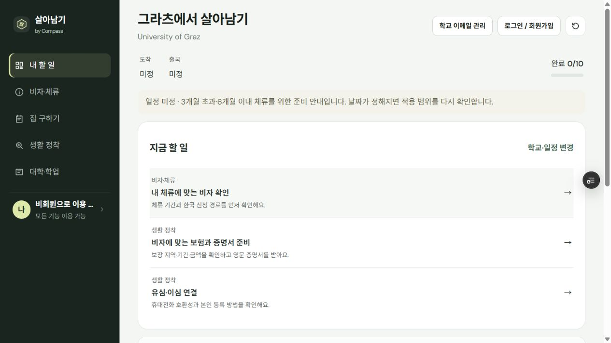

# Compass · ___에서 살아남기

**교환학생 준비를 위한 정보를 나만의 준비 목록으로 연결하는 웹서비스.**

[서비스 체험하기](https://compass-puce-gamma.vercel.app) · [프로젝트 목록으로 돌아가기](README.md)

| 항목 | 내용 |
|---|---|
| 주요 사용자 | 파견이 확정된 뒤 출국·현지 정착을 준비하는 한국 출발 교환학생 |
| 해결하려는 문제 | 여러 곳에 흩어진 안내를 자신의 학교·체류 조건에 맞는 실행 순서로 정리하기 어려움 |
| 주요 영역 | 비자·체류, 집 구하기, 생활 정착, 대학·학업 |
| 이용 방식 | 웹 브라우저에서 비회원으로 체험, 계정 저장은 선택 기능 |
| 기록 기준 | 2026-10-16 구현·검증 상태 |

## 1. 어떤 문제를 다루는가

교환학생 준비 정보는 대학 홈페이지, 정부 안내, 학교 이메일과 개인 메모에 나뉘어 있습니다. 같은 주제라도 학교·체류 기간·프로그램에 따라 적용 조건이 달라집니다.

Compass는 정보를 모아 보여주는 데서 한 단계 더 나아가, **지금 해야 할 일, 확인할 공식 출처, 완료 기준**을 함께 볼 수 있도록 구성했습니다.

## 2. 직접 체험하기

1. [Compass](https://compass-puce-gamma.vercel.app)를 엽니다.
2. 국가·학교를 검색해 파견대학을 선택합니다. 상세 안내 예시는 **University of Graz** 또는 **Brigham Young University**에서 확인할 수 있습니다.
3. 날짜가 미정이면 비워 둔 채 **내 할 일 만들기**를 누릅니다.
4. 준비 목록에서 비자·주거·생활 업무와 출처를 살펴보고, **대학·학업** 메뉴도 확인합니다.

비회원 작업은 현재 탭의 메모리에만 유지되므로 새로고침하거나 창을 닫으면 사라집니다. 일반 회원가입은 현재 닫혀 있으며, 기본 체험에는 계정이 필요하지 않습니다.

*비회원 Preview 환경의 화면입니다. 날짜와 개인 기록을 입력하지 않은 예시이며, 실제 사용자 자료는 포함하지 않았습니다.*

## 3. 주요 기능

| 기능 | 사용자가 할 수 있는 일 | 설계에서 고려한 점 |
|---|---|---|
| 학교·조건별 준비 목록 | 학교와 체류 조건을 선택하고 할 일·진행 상태 확인 | 날짜 미정 상태로도 시작하고, 조건이 바뀌면 해당 문맥의 안내 사용 |
| 비자·주거·생활 안내 | 업무별 출처·적용 조건·완료 기준 확인 | 출처를 열어 본 것과 업무를 완료한 것을 구분 |
| 대학·학업 도구 | 대학 정보 비교, 과목 가져오기, 수강계획 검토 | 과목 정보가 있다는 이유만으로 수강 가능·학점인정을 확정하지 않음 |
| 개인 기록 | 비회원 체험, 선택 로그인 후 저장·백업·복원 | 로그인 전에 작성하던 내용과 기존 계정 기록의 처리 방식을 사용자가 선택 |
| 학교 자료 확인 | 검토·동의한 이메일·문서와 기존 안내의 차이 비교 | 개인에게만 적용되는 예외와 공용 안내 변경을 구분하고, 공용 반영은 운영자가 검토 |

## 4. 설계에서 다룬 질문

### 바로 써볼 수 있으면서 개인 기록은 어떻게 다룰까?

기본 탐색과 준비 목록은 비회원으로 사용할 수 있습니다. 기록을 계정에 보관할 때는 로그인 후 현재 작업과 기존 저장 내용을 비교하고 선택하게 했습니다. 저장 실패나 동시 수정 충돌을 조용히 덮어쓰지 않고 사용자에게 표시합니다.

### 학교마다 다른 안내를 어떻게 표현할까?

Graz·BYU의 상세 안내와 다른 학교의 공통 준비 안내를 구분합니다. 학교가 목록에 있다는 것과 해당 학교의 모든 규정을 검증했다는 것을 같은 의미로 표시하지 않습니다. 출처와 적용 대상을 함께 확인하도록 구성했습니다.

### 과목 수집 장애가 방문자의 조회에 영향을 주지 않게 하려면?

과목 자료의 수집과 웹사이트 조회를 분리했습니다. 운영 도구에서 수집·검토한 자료를 보관하고, 방문자는 해당 사본을 조회합니다. 자료가 없는 학교·학기는 직접 입력이나 PDF·CSV 가져오기로 보완할 수 있습니다.

### AI가 발견한 차이를 어디까지 반영할까?

파일을 읽는 단계와 서버로 전송하는 단계를 구분하고, 사용자가 내용을 검토하고 동의한 뒤 분석합니다. 결과는 근거·학교·학기·적용 범위를 확인하며, 개인 안내 반영과 공용 제보를 별도로 처리합니다. 공용 안내 게시에는 운영자 검토가 필요합니다.

## 5. 구현 개요

| 영역 | 사용한 기술과 역할 |
|---|---|
| 화면 | HTML, CSS, JavaScript ES modules |
| 웹 배포·API | Vercel 정적 사이트와 Node API Functions |
| 선택 계정 저장 | Supabase Auth·Postgres |
| 자료 확인 | 브라우저의 이메일·PDF 처리와 서버의 AI 분석·OCR |
| 과목 자료 관리 | Node·SQLite 수집 도구와 공개용 JSON 보관 자료 |
| 자동 검증 | Node 테스트, Playwright, 공개 파일·정적 자료 검사, GitHub Actions |

코드는 브라우저 전용·서버 전용·공용 규칙으로 나누고, 그 안에서 기능별로 분류합니다. 테스트, 운영 명령, 입력 자료와 문서는 각각 별도로 관리합니다.

## 6. 확인한 결과와 현재 범위

2026-10-16의 저장소 구조 재편 이후 검증 기록입니다. 아래 수치는 테스트와 데이터 사본의 범위이며, 이용자 수나 서비스 전체의 정확도를 뜻하지 않습니다.

| 확인 항목 | 결과 |
|---|---|
| Node 자동 테스트 | 201개 통과 |
| 브라우저 시나리오 | 39개 통과 — 비회원·계정·자료 확인·인증 콜백 흐름 포함 |
| 공개·비공개 파일 경계 | 필요한 자산 제공과 서버 코드·환경 파일·DB 경로 차단 확인 |
| 배포 후 확인 | 운영 주소의 자산·과목 자료와 API 접근 제한 확인 |

자료 사본에는 일반교환 169개와 특별교환 3개를 합쳐 **172개 대학 항목**이 있습니다. 과목 자료는 **17개 대학·학기 조합, 10,142개 레코드**이며, 전체 학교의 과목을 포함하지 않습니다.

자동 브라우저 검사는 외부 인증·DB·AI 응답의 테스트 대역을 사용합니다. 이 결과를 실제 모든 계정·기관·문서에서의 정확도나 AI 분석 정확도로 해석하지 않습니다.

## 7. 체험 시 알아둘 점

- 국가·학교마다 안내의 상세도와 검토 범위가 다릅니다. 실제 신청·계약·수강 결정은 해당 기관의 공식 안내를 확인해야 합니다.
- 과목 자료는 수집 시점의 보관 자료입니다. 실제 개설 여부, 교환학생 수강 가능 여부와 학점인정은 별도 확인이 필요합니다.
- 자료 분석은 사용자가 확인하고 동의한 내용을 처리합니다. 단순 체험에는 실제 개인정보나 학교 이메일을 입력할 필요가 없습니다.

---

[서비스 체험하기](https://compass-puce-gamma.vercel.app) · [Log from Hwang](README.md)
